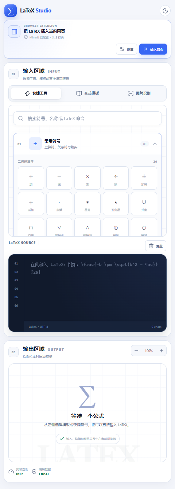
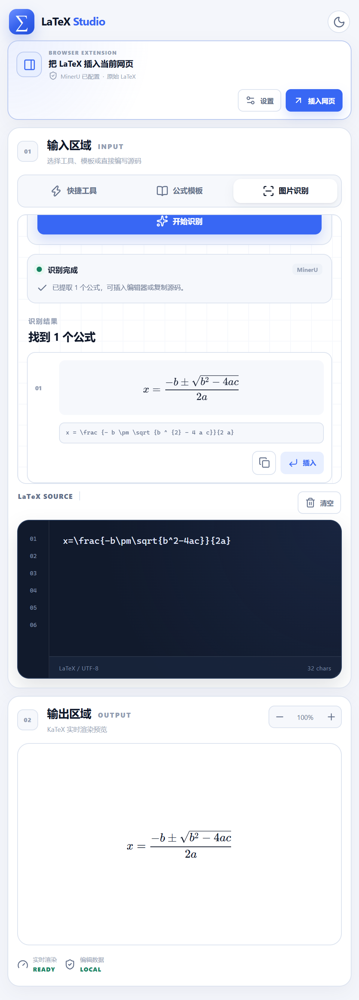

# LaTeX Studio

一个聚焦公式工作流的 Web 应用和 Chrome/Edge 浏览器扩展，包含：

- **快捷工具**：10 个分类、284 个符号与结构、搜索、最近使用与光标插入。
- **公式模板**：10 个分类、60 个可检索公式模板、KaTeX 实时预览。
- **图片识别**：上传、拖拽、剪贴板粘贴，接入 MinerU 精准解析 API。
- **浏览器扩展**：Manifest V3 侧边栏，可把编辑好的 LaTeX 插入当前网页输入框或 contenteditable 编辑区。

支持浅色/深色主题和响应式布局。

## 技术栈

- React + Vite + TypeScript
- KaTeX
- Manifest V3 + Side Panel API
- Node.js HTTP API service
- MinerU 精准解析 API
- `fflate` ZIP 解包
- Playwright + Node 内置测试运行器

## Web 启动

```powershell
npm install
npm run dev
```

- 前端：http://localhost:5173
- API：http://localhost:8787

未配置任何环境变量时，Web 图片识别运行在 Mock 模式。

## Web 端 MinerU 配置

创建 `.env.local`：

```powershell
Copy-Item .env.example .env.local
```

填写：

```env
MINERU_API_TOKEN=你的服务端Token
MINERU_MODEL_VERSION=vlm
MINERU_LANGUAGE=ch
MINERU_MOCK_MODE=false
PORT=8787
```

安全要求：

- Web 端 Token 只由 Node 服务读取。
- 不要写入 `VITE_*`、前端源码或响应内容。
- `.env.local` 已被 `.gitignore` 忽略。
- 图片默认不落盘，也不写入数据库。
- 仅允许 PNG、JPEG、WebP，单文件最大 10 MB。

## 浏览器扩展

构建：

```powershell
npm run build:extension
```

产物：

- `extension-dist/`：Chrome/Edge“加载已解压的扩展程序”目录。
- `release/latexlive-studio-extension-v0.1.1.zip`：安装/发布 ZIP。

安装：

1. 打开 `chrome://extensions` 或 `edge://extensions`。
2. 开启“开发者模式”。
3. 点击“加载已解压的扩展程序”。
4. 选择 `E:\code\LatexLive\extension-dist`。
5. 打开扩展“设置”，填写 MinerU Token。
6. 在普通网页的输入框/编辑区放置光标，打开扩展侧边栏。
7. 编辑公式后点击“插入网页”。

扩展 Token 模式：

- Token 保存在 `chrome.storage.local`。
- 不会打入 ZIP、写入源码或输出到日志。
- 侧边栏优先，所有 MinerU API、签名上传和 ZIP 下载请求都经过扩展 Service Worker 代理。
- 为兼容 MinerU/OSS 的浏览器来源限制，扩展仅对三个受信任域名范围移除 `Origin`/`Referer`：
  - `mineru.net/api/v4/*`
  - `*.aliyuncs.com/*`
  - `*.openxlab.org.cn/*`
- 该模式适合个人/内部安装；若公开分发，应改为你自己的后端代理 MinerU。

扩展支持：

- `textarea`
- `text/search/tel/url/email` input
- 常见 `contenteditable` 编辑区
- `Ctrl+Shift+L` / `Command+Shift+L` 打开侧边栏

## 验证

```powershell
npm run verify
npm run smoke:extension
npm test
```

Web 浏览器回归：

```powershell
npm run build
npm run smoke
```

`npm run smoke` 会自动启动一个隔离的 Mock API 服务，不会使用 `.env.local` 中的真实 MinerU 模式；覆盖 Web 三项核心流程、公式搜索、全部 KaTeX 渲染、深色主题和 390px 移动端布局。

`npm run smoke:extension` 会实际加载 `extension-dist`，验证侧边栏、设置页、Chrome Storage 和 480px 布局，并生成：

- `artifacts/extension-sidepanel.png`
- `artifacts/extension-options.png`

## 目录

```text
src/
  components/          React UI
  data/                快捷工具与公式模板数据
  lib/                 KaTeX、Extension 设置、直连 OCR
server/
  index.mjs            Web API + 静态文件服务
  mineru.mjs           Web MinerU Provider
  ocr-utils.mjs        图片校验 + 共享解析器导出
  mock-ocr.mjs         本地演示 Provider
shared/
  formula-parser.mjs   Node/浏览器共用公式提取器
extension/
  manifest.json        Manifest V3
  background.js        侧边栏和网页消息
  content/             页面光标跟踪与插入
  options.*            扩展设置页
  icons/               PNG 图标
extension-dist/        生成的可加载扩展
release/               生成的 ZIP
.agents/
  project.yaml         项目状态与命令
  architecture.md      架构和请求流
  tasks/               agent 任务看板
  decisions/           架构决策记录
  verification/        验证证据
```

Agent 协作以 [AGENTS.md](./AGENTS.md) 为准。

## 当前验证边界

Web 端、扩展侧边栏、设置页、页面插入脚本和扩展打包均已验证。扩展端真实 MinerU OCR 已用一张自动生成的测试公式图完成上传、轮询、ZIP 下载、公式提取和渲染。Chrome Web Store 注册和公开发布仍需要开发者账号、商店截图与隐私政策材料。

## 开源与许可证

本项目以 **Apache License 2.0** 开源。

- [LICENSE](LICENSE)
- [NOTICE](NOTICE)
- [THIRD_PARTY_NOTICES.md](THIRD_PARTY_NOTICES.md)
- [PRIVACY.md](PRIVACY.md)
- [SECURITY.md](SECURITY.md)
- [CONTRIBUTING.md](CONTRIBUTING.md)
- [CODE_OF_CONDUCT.md](CODE_OF_CONDUCT.md)
- [CHANGELOG.md](CHANGELOG.md)

## 不进入源码仓库的内容

以下内容已通过 `.gitignore` 排除：

- `.env.local` 中的真实 Token
- `latexlive-assistant-0.1.5/` 第三方参考扩展
- `node_modules/`
- `dist/`、`extension-dist/`
- `release/` 安装 ZIP
- `artifacts/` 测试截图和浏览器临时配置

安装 ZIP 应作为独立发布产物分发，而不是提交到源码历史。若需要在 Git 历史中加入发布包，也应先确认其中没有 Token、用户图片或签名上传 URL。

## 贡献与安全问题

- 功能与缺陷修复请阅读 [CONTRIBUTING.md](CONTRIBUTING.md)。
- 安全漏洞请按照 [SECURITY.md](SECURITY.md) 私下报告。
- 不要在 Issue、PR、截图或日志中公开 MinerU Token、签名URL、私有图片或个人信息。

## 界面截图

### 扩展侧边栏



### 扩展设置


### 真实 MinerU 识别结果



截图中的 MinerU Token 为测试占位值，不包含真实凭据。
