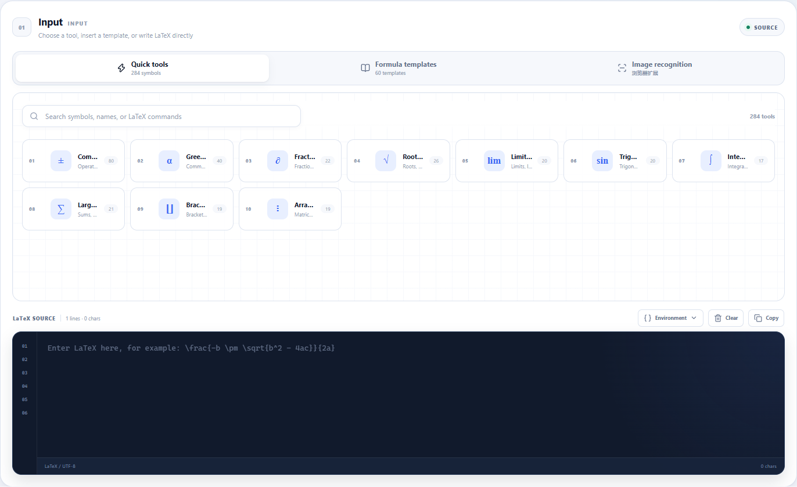
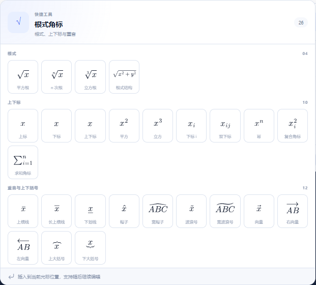
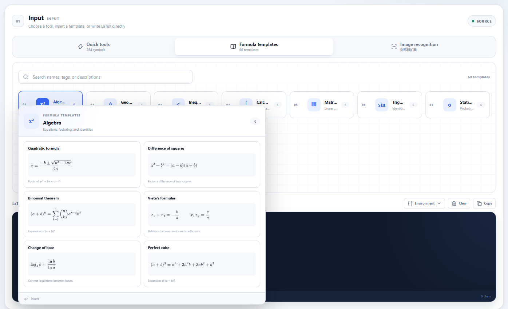
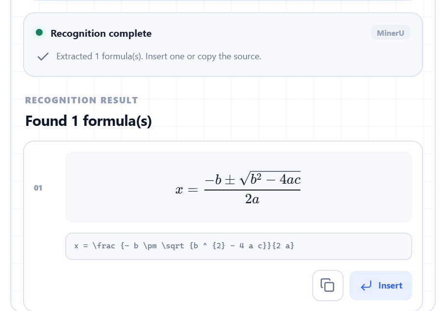
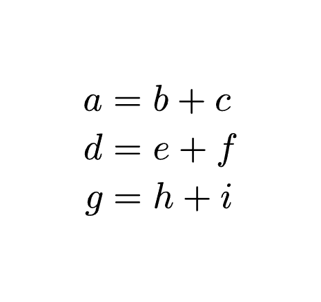
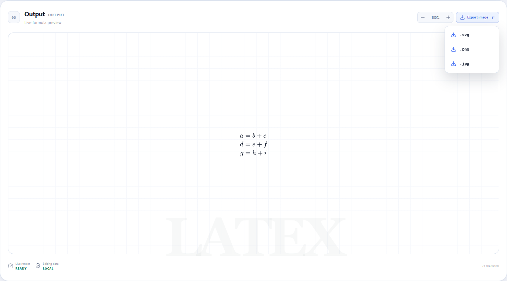

  
  <h1>FormulaDock</h1>
  
<strong>Write, preview, export, and recognize LaTeX formulas in one focused workspace.</strong>

  
<a href="https://dlct-wzx.github.io/formula-dock/"><strong>Open the live demo →</strong></a>

  

    <a href="README.md">English</a> ·
    <a href="README_ZH.md">简体中文</a> ·
    <a href="../../releases/latest">Download</a> ·
    <a href="#install-the-extension">Install</a>
  

  

    
    
    
    
  

FormulaDock is a browser-based LaTeX formula workspace built for people who write formulas every day. It combines a searchable symbol library, ready-made formula templates, a live editor, high-resolution image export, and optional MinerU-powered image recognition in a clean Chrome/Edge side panel.

No account is required. Formula editing, rendering, templates, and exports stay in your browser.

## Highlights

- **284 quick tools across 10 categories** — Find common symbols, operators, roots, scripts, integrals, matrices, and more.
- **60 formula templates across 10 topics** — Start quickly with algebra, geometry, calculus, matrices, trigonometry, statistics, sequences, physics, and chemistry.
- **MathJax 4 by default, KaTeX optional** — Switch renderers in settings. MathJax 4 handles complex multi-line formulas especially well.
- **Built for real formula layouts** — Every quick-tool card measures and scales its own preview, so wide or tall formulas remain fully visible.
- **Part of the keyboard workflow** — Open the side panel with `Ctrl+Shift+L` on Windows/Linux or `Command+Shift+L` on macOS.
- **Formula image export** — Download transparent SVG or PNG, or a white-background JPG.
- **Image recognition in the extension** — Configure your own MinerU API key and turn formula screenshots into editable LaTeX.
- **Chinese and English UI** — Adjust interface language, interface text size, and editor font size independently.
- **Light and dark themes** — Follow your preference in both the web workspace and side panel.

## Three ways to start a formula

### 1. Pick a symbol

Hover over a category to open its formula grid. Cards are sized to keep the complete formula visible, then insert the selected symbol directly at the editor caret.

### 2. Start from a template

Browse templates by topic or search by name, tag, and description. Each preview uses the renderer selected in Settings.

### 3. Paste or recognize an image

In the browser extension, upload, drag, or paste a formula image. FormulaDock sends it to MinerU using your own API key, extracts the LaTeX candidates, and lets you insert or copy the result.

## Editor and output

- Live MathJax 4 or KaTeX preview.
- Multi-line LaTeX environments, including `align`, `aligned`, `eqnarray`, `gathered`, `cases`, `split`, and `array`.
- One-click environment insertion from the LaTeX Source toolbar.
- Wide formulas scroll horizontally inside the output card without stretching the page.
- Preview zoom controls for checking fine details.
- Transparent SVG/PNG export and white-background JPG export.

## Install the extension

FormulaDock currently installs from the repository's GitHub Releases page.

1. Open [GitHub Releases](../../releases/latest).
2. Download the latest `formuladock-extension-v*.zip` package and unzip it.
3. Open `chrome://extensions` in Chrome or `edge://extensions` in Edge.
4. Enable **Developer mode**.
5. Choose **Load unpacked** and select the unzipped folder.
6. Pin FormulaDock and click its toolbar icon to open the side panel.

For image recognition, open **Settings**, paste your MinerU API key, and choose the model and OCR language.

> FormulaDock does not read, modify, or insert content into the current webpage. The extension does not request access to the active tab.

## Privacy and permissions

- The web workspace does **not** upload images or expose OCR controls.
- Formula images are uploaded only when you explicitly start recognition in the extension.
- Your MinerU API key is stored locally in `chrome.storage.local`.
- FormulaDock does not include analytics, advertising, telemetry, or user accounts.
- The extension requests only side-panel, storage, and MinerU-network permissions. It does not request webpage access.
- Uploaded images are processed for the recognition request and are not written to project storage by FormulaDock.

See [PRIVACY.md](PRIVACY.md), [SECURITY.md](SECURITY.md), and the extension permission details for more information.

## Rendering and exports

| Capability | Details |
|---|---|
| Default renderer | MathJax 4 with SVG output |
| Alternate renderer | KaTeX |
| Multi-line environments | `align`, `aligned`, `eqnarray`, `gathered`, `cases`, `split`, and `array` |
| Output formats | SVG, PNG, JPG |
| Transparency | Transparent SVG and PNG; JPG uses white |
| Local rendering | KaTeX, MathJax, fonts, and glyph assets are packaged with the app |

All 284 quick-tool previews and 60 formula templates are checked against both rendering engines.

## Compatibility

- Chrome 116+
- Microsoft Edge 116+
- Modern browsers for the web workspace
- MinerU API access is required only for image recognition
- The editor, templates, local rendering, and exports do not require an account

## FAQ

### Is image recognition available on the website?

No. Recognition is available only in the browser extension. The website explains how to install the extension and configure a personal MinerU API key.

### Do I need a MinerU API key?

Only if you want to use image recognition. Editing, templates, MathJax/KaTeX rendering, and image export do not require a key.

### Does FormulaDock change the page I am visiting?

No. It works in a dedicated side panel and does not request active-page access.

### Can I use it offline?

The editor, formula data, local renderers, and exports are packaged locally. MinerU image recognition requires an internet connection.

### Which renderer should I use?

MathJax 4 is the default and is the better choice for complex multi-line environments. KaTeX offers a lighter, synchronous rendering path and can be selected in Settings.

## Contributing

Bug reports, formula corrections, and feature suggestions are welcome through [GitHub Issues](../../issues). Please read [CONTRIBUTING.md](CONTRIBUTING.md) before submitting a pull request.

For security-sensitive reports, follow [SECURITY.md](SECURITY.md). Never post API keys, private images, or signed upload URLs publicly.

## License

FormulaDock is open source under the [Apache License 2.0](LICENSE).

Third-party trademarks and licenses remain with their respective owners. See [NOTICE](NOTICE) and [THIRD_PARTY_NOTICES.md](THIRD_PARTY_NOTICES.md) for details.

---

  FormulaDock · A focused workspace for formulas

