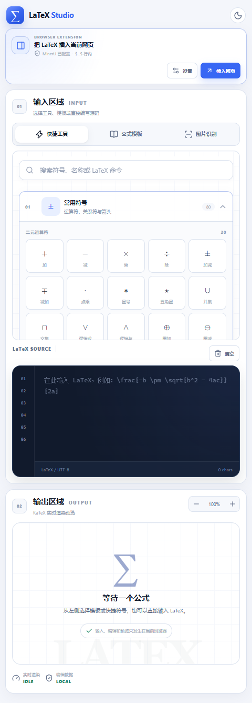
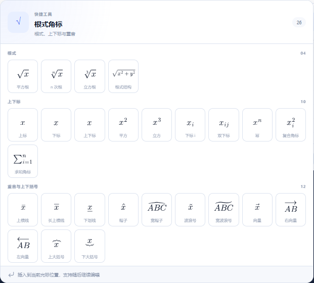
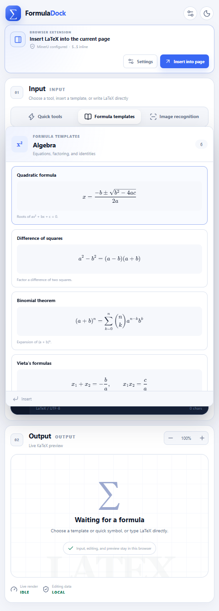
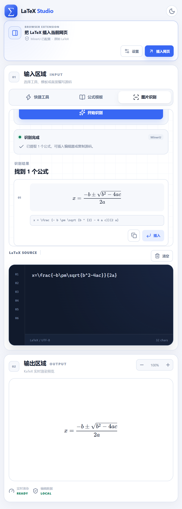
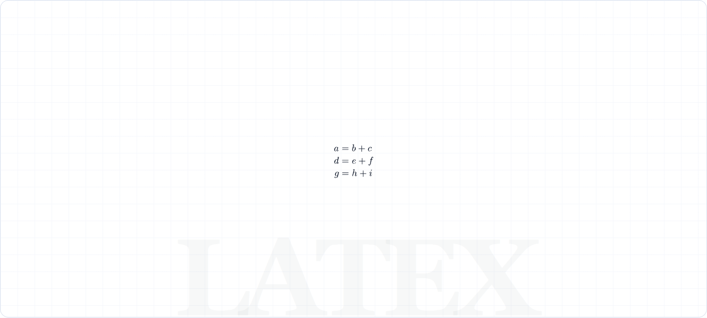
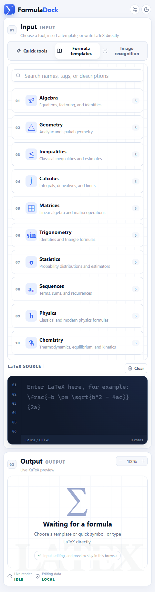
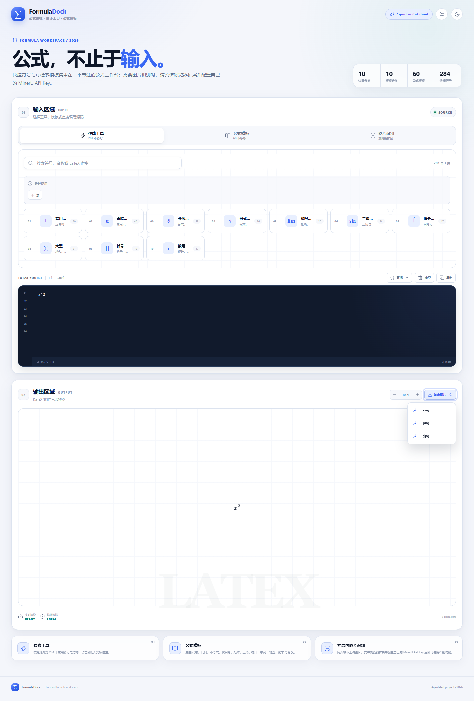
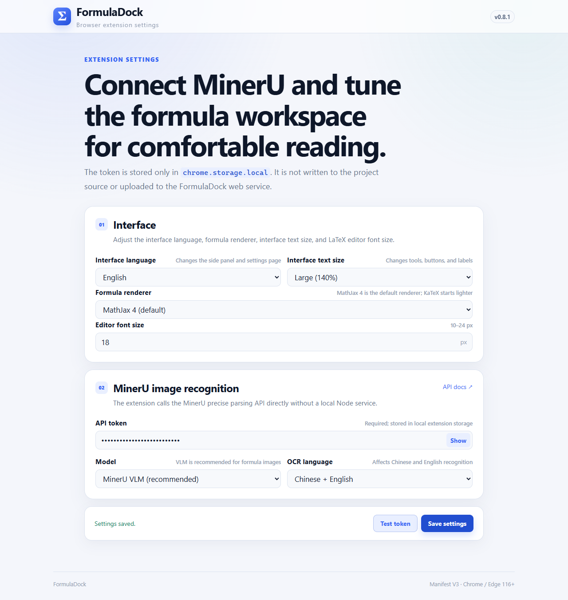

  
  <h1>FormulaDock</h1>
  
<strong>在一个专注的工作台中编写、预览、导出与识别 LaTeX 公式。</strong>

  

    <a href="README.md">English</a> ·
    <a href="README_ZH.md">简体中文</a> ·
    <a href="../../releases/latest">下载</a> ·
    <a href="#安装扩展">安装</a>
  

  

    
    
    
    
  

FormulaDock 是一个面向日常公式编辑的浏览器 LaTeX 工作台。它将可搜索的符号库、现成公式模板、实时编辑器、高分辨率图片导出，以及可选的 MinerU 图片识别整合到干净的 Chrome/Edge 侧边栏中。

无需注册账号。公式编辑、渲染、模板和图片导出均在浏览器本地完成。

## 功能亮点

- **10 类、284 个快捷工具**：快速查找常用符号、运算符、根式、上下标、积分、矩阵等内容。
- **10 类、60 个公式模板**：覆盖代数、几何、不等式、微积分、矩阵、三角、统计、数列、物理和化学。
- **默认 MathJax 4，可切换 KaTeX**：在设置中选择渲染器。MathJax 4 对复杂多行公式的兼容性更好。
- **公式卡片自动适配**：每个快捷工具都会独立测量并缩放预览，宽公式或高公式也不会被裁切。
- **适合键盘工作流**：Windows/Linux 使用 `Ctrl+Shift+L`，macOS 使用 `Command+Shift+L` 打开侧边栏。
- **公式图片导出**：支持透明 SVG、透明 PNG 和白色背景 JPG。
- **扩展内图片识别**：配置自己的 MinerU API Key，将公式截图转换成可编辑的 LaTeX。
- **中英文界面**：界面语言、界面字号和编辑器字号可以分别设置。
- **浅色与深色主题**：网页工作台和扩展侧边栏均可切换。

## 三种开始方式

### 1. 选择符号

将鼠标移到分类卡片上即可展开公式面板。每张卡片都会完整显示公式，点击后从编辑器光标处插入。

### 2. 使用公式模板

按主题浏览模板，或按名称、标签和描述搜索。模板预览会使用当前选择的公式渲染器。

### 3. 粘贴或识别图片

在浏览器扩展中上传、拖入或粘贴公式图片。FormulaDock 会使用你自己的 API Key 将图片发送到 MinerU，提取 LaTeX 候选，并支持插入或复制。

## 编辑与输出

- MathJax 4 或 KaTeX 实时预览。
- 支持 `align`、`aligned`、`eqnarray`、`gathered`、`cases`、`split`、`array` 等多行环境。
- LaTeX 源码工具栏可一键插入常用环境。
- 宽公式在输出卡片内部横向滚动，不撑破页面。
- 支持预览缩放，便于检查细节。
- 支持透明 SVG/PNG 和白色背景 JPG 导出。

## 安装扩展

目前可通过仓库的 GitHub Releases 页面安装 FormulaDock。

1. 打开 [GitHub Releases](../../releases/latest)。
2. 下载最新的 `formuladock-extension-v*.zip` 并解压。
3. 在 Chrome 中打开 `chrome://extensions`，或在 Edge 中打开 `edge://extensions`。
4. 开启 **开发者模式**。
5. 点击 **加载已解压的扩展程序**，选择解压后的文件夹。
6. 固定 FormulaDock，并点击工具栏图标打开侧边栏。

如需图片识别，请打开 **设置**，填写 MinerU API Key，并选择模型与 OCR 语言。

> FormulaDock 不会读取、修改或向当前网页插入内容，也不会申请访问当前标签页的权限。

## 隐私与权限

- 网页工作台**不会**上传图片，也不提供 OCR 控件。
- 只有你在扩展中主动开始识别时，公式图片才会被上传。
- MinerU API Key 仅保存在本机的 `chrome.storage.local`。
- FormulaDock 不包含分析、广告、遥测或用户账号。
- 扩展仅申请侧边栏、存储和 MinerU 网络相关权限，不申请网页访问权限。
- 上传图片只用于当前识别请求，FormulaDock 不会将其写入项目存储。

更多信息请查看 [PRIVACY.md](PRIVACY.md)、[SECURITY.md](SECURITY.md) 和扩展权限说明。

## 渲染与导出

| 能力 | 说明 |
|---|---|
| 默认渲染器 | MathJax 4，SVG 输出 |
| 可选渲染器 | KaTeX |
| 多行环境 | `align`、`aligned`、`eqnarray`、`gathered`、`cases`、`split` 和 `array` |
| 图片格式 | SVG、PNG、JPG |
| 背景 | SVG/PNG 透明，JPG 白色 |
| 本地资源 | KaTeX、MathJax、字体与字形资源均随项目打包 |

全部 284 个快捷工具预览和 60 个公式模板均已通过 KaTeX 与 MathJax 4 双引擎检查。

## 界面截图

| 快捷工具 | 公式模板 |
|:-:|:-:|
|  |  |

| MathJax 公式 | 图片导出 |
|:-:|:-:|
|  |  |

## 兼容性

- Chrome 116+
- Microsoft Edge 116+
- 现代浏览器可运行网页工作台
- 只有图片识别需要 MinerU API
- 编辑器、模板、本地渲染与图片导出均无需账号

## 常见问题

### 网页端支持图片识别吗？

不支持。图片识别仅在浏览器扩展中提供。网页端会提示安装扩展并配置个人 MinerU API Key。

### 必须提供 MinerU API Key 吗？

只有使用图片识别时才需要。公式编辑、模板、MathJax/KaTeX 渲染和图片导出都不需要 Key。

### FormulaDock 会修改我正在访问的网页吗？

不会。它在独立侧边栏中运行，不申请当前网页的访问权限。

### 可以离线使用吗？

编辑器、公式数据、本地渲染器和图片导出均随扩展打包。MinerU 图片识别需要网络连接。

### 应该选择哪个渲染器？

MathJax 4 是默认选项，更适合复杂多行公式。KaTeX 启动更轻量、渲染为同步路径，可在设置中切换。

## 参与贡献

欢迎通过 [GitHub Issues](../../issues) 提交问题、公式修正和功能建议。提交 Pull Request 前请阅读 [CONTRIBUTING.md](CONTRIBUTING.md)。

安全相关问题请按照 [SECURITY.md](SECURITY.md) 私下报告。请勿在公开 Issue、截图或日志中发布 API Key、私人图片或带签名的上传 URL。

## 许可证

FormulaDock 使用 [Apache License 2.0](LICENSE) 开源。

第三方商标与许可证归各自权利人所有。详情请查看 [NOTICE](NOTICE) 和 [THIRD_PARTY_NOTICES.md](THIRD_PARTY_NOTICES.md)。

---

  FormulaDock · 专注于公式的工作台

